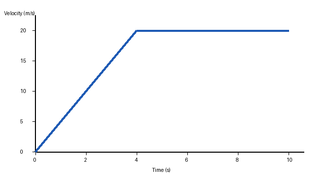

## Passage
ID: sample-reading-p1
Title: Cooling the City

Cities are often several degrees warmer than the countryside around them, an effect known as the urban heat island. Pavement and rooftops absorb sunlight during the day and release it slowly at night. Trees counter this in two ways. Their canopies shade surfaces that would otherwise heat up, and their leaves release water vapor, which cools the surrounding air as it evaporates. For this reason, some city planners now treat trees less as decoration and more as infrastructure, as essential to a neighborhood as its storm drains.

## Question
ID: sample-reading-1
Passage: sample-reading-p1
Tags: Reading, Main Idea

### Stem
Which choice best states the main purpose of the passage?

### Choices
A. To argue that cities should replace pavement with grass
B. To explain how trees reduce urban heat and why planners value them
C. To compare the climates of cities and rural areas in detail
D. To describe the history of storm drain construction

### Answer
B

### Explanation
The passage describes the urban heat island, explains the two ways trees cool cities, and ends with how planners have come to view trees. Choice B captures all of this.

### Educational Objective
A main-purpose answer must cover the whole passage, not a single detail.

## Question
ID: sample-reading-2
Passage: sample-reading-p1
Tags: Reading, Vocabulary in Context

### Stem
As used in the passage, "counter" most nearly means

### Choices
A. oppose
B. tally
C. display
D. surface

### Answer
A

### Explanation
Trees work against the heat island effect, so "counter" means "oppose."

### Educational Objective
Choose the meaning that fits the sentence, not the word's most common meaning.

## Question
ID: sample-math-1
Tags: Math, Algebra
Keep order: yes

### Stem
If $3x + 7 = 22$, what is the value of $x$?

### Choices
A. 3
B. 5
C. 7
D. 15

### Answer
B

### Explanation
Subtract 7 from both sides to get $3x = 15$, then divide by 3:

$$x = \frac{15}{3} = 5$$

### Educational Objective
Undo operations in reverse order to isolate the variable.

## Question
ID: sample-physics-1
Tags: Physics, Kinematics
Keep order: yes

### Stem
The graph shows the velocity of a cart over time.

What is the cart's acceleration during the first 4 seconds?

### Choices
A. 2 m/s²
B. 5 m/s²
C. 10 m/s²
D. 20 m/s²

### Answer
B

### Explanation
Acceleration is the slope of a velocity–time graph: $a = \dfrac{\Delta v}{\Delta t} = \dfrac{20 - 0}{4 - 0} = 5\ \text{m/s}^2$.

### Educational Objective
On a velocity–time graph, the slope is acceleration.
